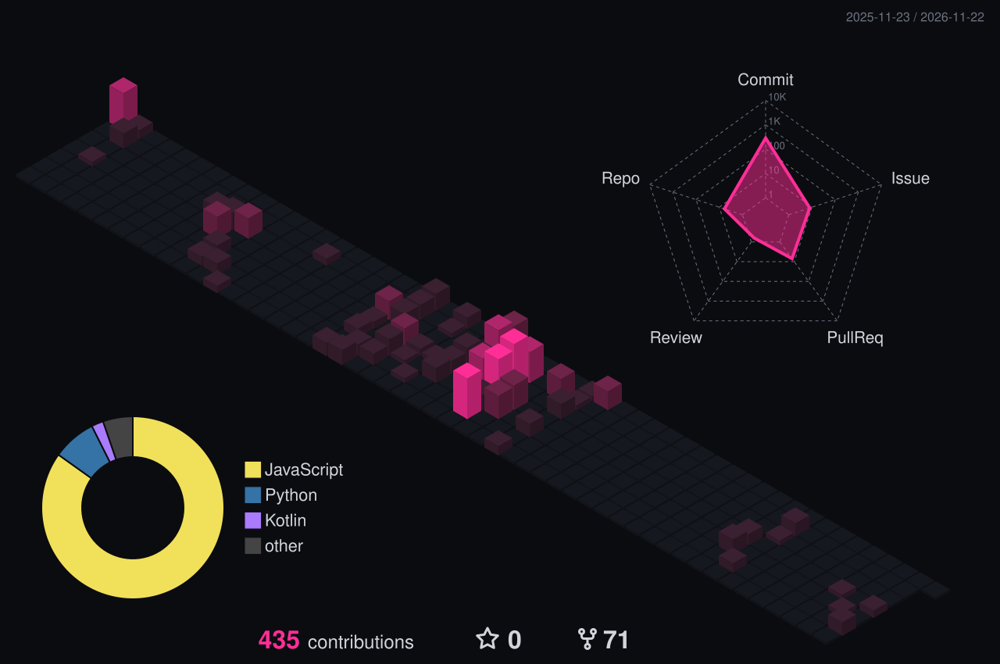

<p align="center">
  
</p>

<p align="center">
  
</p>

<p align="center">
  
  
  
</p>

<p align="center">
  
</p>

<h2>⚡ <code>$ ls ~/stack</code></h2>

<p align="center">
  <br/>
  
</p>

<h2>🛸 <code>$ git remote -v</code></h2>

<p align="center">
  <a href="https://github.com/mestupinanm/ProyectoBase">
    
  </a>
  <a href="https://github.com/mestupinanm/dapp-angular-taller">
    
  </a>
</p>

<h2>📡 <code>$ git log --stats</code></h2>

<p align="center">
  
  
</p>
<p align="center">
  
</p>

<h2>🧊 <code>$ render --3d contributions</code></h2>

<p align="center">
  
</p>

<p align="center">
  
</p>

```bash
❯ echo "¿hablamos de código, web3 o arte generativo?"
> open an issue · ping me 💗
❯ exit
[process completed]
```
